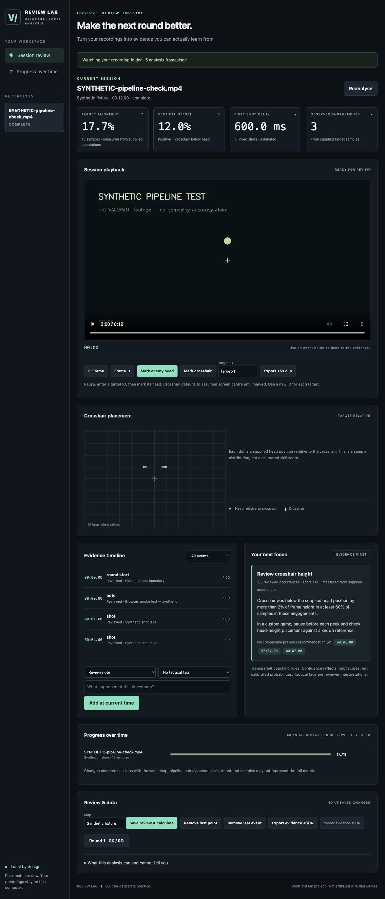

# VALORANT Review Lab

**Local post-match video processing, review and evidence-based practice notes.**

Review Lab expands the original Valorant Match Notes CSV utility into a local application.
It watches a recording folder, processes completed recordings in the background, provides
seekable playback and clips, and calculates aim measurements from explicitly supplied evidence.
The original `summary.py` command still works.

> **Current status:** a working foundation and review-assisted analysis tool, not a validated
> automatic VALORANT coach. No real gameplay footage or trained VALORANT head model was
> available during development. By default, the only automatic visual events are **scene-change
> candidates**. Kills, deaths, rounds, shots and tactical labels need manual review or configured,
> independently validated detectors. Empty data produces empty metrics, never sample statistics.



*The screenshot uses generated test geometry, not VALORANT footage or real player statistics.*

## Start locally

Python **3.10+**. Tested locally on macOS with Python 3.12; GitHub Actions covers Python 3.10/3.12 on Linux.

```sh
git clone https://github.com/HotLikeTobasco/valorant-match-notes.git
cd valorant-match-notes
# Until the feature PR is merged:
git switch feature/local-vod-analysis
python3 -m venv .venv
source .venv/bin/activate
python -m pip install -e '.[test]'
cp config.example.json config.json
```

On Windows, activate with `.venv\Scripts\Activate.ps1` in PowerShell and use
`Copy-Item config.example.json config.json` instead of `cp` if preferred.

Edit `recordings_dir` in `config.json` to the folder that contains your recordings. Use an
absolute path, `~`, or a path relative to where you launch the app. JSON Windows paths can
use forward slashes, such as `C:/Users/you/Videos/VALORANT`.

```sh
python -m valorant_lab --config config.json
```

Open **http://127.0.0.1:8765**. The app binds to loopback only and uses one background worker.
Stop with Ctrl+C. Do not expose it to the internet or run multiple workers against one data directory.
A process lock prevents a second dashboard worker using the same directory.

FFmpeg is supplied by `imageio-ffmpeg` on supported platforms; set `FFMPEG_BINARY` to your
system FFmpeg executable if needed. OpenCV supplies decoding. A readable H.264/AAC playback
proxy is generated so MKV and other source containers can play in the browser.

### OBS and ingestion

In OBS, find **Settings → Output → Recording → Recording Path** and use that directory in
`config.json`. No OBS plugin, websocket connection, game overlay or live input capture is needed.
MP4, MKV, MOV, AVI, FLV, WebM and M4V are discovered recursively; codec support depends on
OpenCV/FFmpeg. A file must keep the same size and modification time for `settle_seconds`
(default 30) before it is queued. Changed recordings are queued again after settling.
A temporary pause in an unfinished recording can still look settled; use a separate completed
recordings folder if your recorder pauses writes for long periods.

## Review workflow

1. Select a completed recording. Processing state, progress and errors appear in the session list.
2. Jump through scene candidates or add reviewed kill/death/round/shot events at the playhead.
3. Pause and use **Frame → / ← Frame** for approximate frame stepping (container FPS).
4. Enter a distinct target ID, then **Mark enemy head**. Mark the crosshair on the same frame
   if it differs from the assumed screen centre. Repeat on nearby frames with the same target ID.
5. Link shot annotations to that same target ID. Add tactical tags only after reviewing the video.
6. **Save review & calculate**. Existing video chunks are reused; aim metrics and coaching are recalculated.
7. Use **Export ±5s clip** for a short H.264 clip. The API supports clips up to 120 seconds.
8. Export evidence JSON for backup or offline editing. Remove-last controls correct recent annotations.

The browser editor updates the local database, not the source recording. You may also place an
initial sidecar next to a recording: `match.mp4.evidence.json`. See [the evidence contract](docs/EVIDENCE.md).
Editing that sidecar invalidates the session cache and replaces the saved review on the next scan;
export your review before replacing sidecars. Exported `session.evidence.json` must be renamed
to match the video when used as a sidecar.

## What is implemented

| Area | Available now | Limits |
| --- | --- | --- |
| Foundation | Folder watching, settled-file checks, durable SQLite jobs, chunk resume, progress/errors, browser playback, background clips | One video job and one clip at a time; proxy conversion restarts after interruption |
| Basic detection | Sampled image-change detector; configurable HUD-template detector | Scene changes are not game events; HUD similarity is not a probability |
| Mechanical review | Head/crosshair annotations, observed engagement segmentation, target-relative alignment and vertical offset, alignment variability, linked first-shot delay and shot alignment | Only supplied samples; no automatic flick classification or validated tracking score |
| Models | Replaceable detector protocol; optional ONNX head adapter and available execution-provider selection | No weights bundled, no real-game accuracy result; model must match the documented contract |
| Tactical review | Reviewed round counts, timestamped tactical tags, recurring tagged issue summaries | No world-position inference, automatic counter-strafe, angle-exposure or trade assessment |
| Coaching | Transparent rules, evidence links, occurrence counts, exercises, comparable-session deltas | Rule-based, not generative AI; thresholds are explicit heuristics and are not competitively validated |
| Telemetry | Validated offline JSONL mouse-sample loader and calibrated path calculation | Library interface only; no recorder, dashboard import or automatic video synchronisation |
| Validation | Synthetic video fixtures, precision/recall and numerical-error evaluator, automated tests, CI | Synthetic tests do not establish accuracy on VALORANT footage |

The requested fully automatic mechanical/tactical intelligence remains an open development
stage. In particular, target visibility onset, overshoot/undershoot, spray control, movement at
firing, utility recognition, angle exposure and avoidable engagements cannot be responsibly
claimed from the available data. These are not represented by fabricated dashboard numbers.

## Measurement and confidence

- Alignment is distance from crosshair to supplied head centre, in **percent of frame height**.
  Horizontal displacement is adjusted for aspect ratio. It is not an angle or a hit probability.
- Vertical offset is positive when the crosshair is below the supplied head centre.
- Alignment variability is variation of that distance across samples, not isolated tracking skill.
- First-shot delay is time from the first supplied visible-target sample in an observed engagement
  to its first manually linked shot. It is **not reaction time** and may omit earlier target visibility.
- A gap greater than `max(0.5 s, 2/sample_fps)` splits an observed target run. Sparse annotations
  cannot prove continuous visibility. Shot alignment uses the nearest observation within one sample interval.
- If reviewed target observations exist, they take precedence for the session's aim metrics;
  they are not mixed with unvalidated model observations.
- Confidence fields are reviewer confidence, template similarity or raw model scores. They are
  **not calibrated probabilities**. Assumed-centre crosshairs and model inputs produce estimated metrics.
- At default 5 Hz sampling, timing uncertainty is at least 200 ms, plus annotation/decoder error.
  Container FPS and OpenCV timestamps can drift for variable-frame-rate footage. Do not interpret
  these values as precise reaction-time measurements.
- Session comparisons require the same pipeline configuration, known map label and evidence basis.
  Different annotation coverage or situations can still bias the result. A missing baseline stays missing.

## Performance and reliability

Videos are decoded sequentially; only sampled frames are retrieved/resized for analysis.
Video frames are not loaded as an entire recording. Reports still grow with the number of stored
observations/events. The default analysis width is 640 pixels at 5 samples/sec.

SQLite stores per-chunk results (default 60 seconds). On restart, unfinished jobs resume at their
last committed chunk, with a short overlap to initialise detectors. ONNX target tracks restart at
chunk boundaries and are explicitly scoped per chunk; this can split engagements. Template
candidates are debounced during report assembly. A config/model/template fingerprint invalidates
old analysis, while recording identity uses size plus nanosecond modification time to avoid hashing
multi-hour files. Replacing a file while preserving both attributes requires explicit reanalysis.

Set `hwaccel` to `auto`, `videotoolbox`, `cuda`, `d3d11va` or `vaapi` to try hardware decoding for
FFmpeg proxy generation; failed hardware decode falls back to CPU. Analysis uses OpenCV CPU
decode. ONNX uses an available CUDA/CoreML provider before CPU when installed. None of the
GPU paths has been benchmarked or validated on VALORANT footage here.

Playback proxies and clips consume disk under `data_dir` (default `.lab`). There is no automatic
retention policy. Stop the app before removing obsolete artifact folders. Source recordings are
never modified. Reanalysis of unchanged sources reuses their playback proxy. Clip job status is
in memory and is lost on restart; successfully written clip files remain on disk.

Failed jobs retain useful error text and can be retried. Reanalyse clears analysis chunks; saving
review evidence reuses them. Missing/corrupt files do not stop other queued work. Changing
configuration requires restarting the app. `data_dir` must be outside the watched folder.

## Test and validate

```sh
python -m pytest -q
python summary.py example.csv
```

Generate a reproducible synthetic video **outside your personal recordings folder**:

```sh
python tests/generate_fixture.py /tmp/valorant-synthetic
```

Point a separate local configuration at that directory and use a separate `data_dir` to try the
complete UI. The video and sidecar are labelled synthetic; the image contains generated geometry,
not VALORANT. Screenshots of this fixture must retain that distinction.

To evaluate actual detectors, export automatic detections from
`GET /api/sessions/{id}/detections`, independently label the same footage, then run:

```sh
python -m valorant_lab.validate predictions.json labels.json --width 1920 --height 1080 --tolerance 0.25
```

The evaluator reports per-event precision/recall, matched-event timestamp MAE, head-location
MAE in pixels, and alignment MAE in percent of frame height. Unmatched/absent data does not
become zero error. See [validation protocol](docs/VALIDATION.md) before claiming model quality.

## Repository layout

```text
summary.py                 Original CSV workflow (preserved)
valorant_lab/
  config.py                Configuration and cache signature
  db.py                    SQLite queue and atomic chunk checkpoints
  video.py                 Decode, metadata and cancellable FFmpeg jobs
  detectors.py             Scene, HUD-template and optional ONNX adapters
  schema.py                Versioned, bounded evidence models
  analysis.py              Measurements, round review and coaching rules
  telemetry.py             Offline, opt-in mouse telemetry interface
  validate.py              Independent detector/metric evaluation
  pipeline.py              Settled-file discovery and persistent worker
  app.py                   Local API, playback and clip endpoints
  static/                  Buildless dashboard; no Node toolchain required
 tests/                    Unit, video, API and recovery checks
 docs/                     Audit, evidence/model contracts and validation limits
```

No credentials, private recordings or model weights belong in Git. Default local data/configuration,
recordings and common model extensions are ignored. There are no cloud API keys or remote
coaching services. This app does not inject code, read protected memory, hook the VALORANT
client or interact with Riot Vanguard.

Unofficial fan project. Not affiliated with or endorsed by Riot Games.
